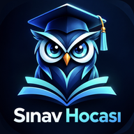

<p align="center"></p>

# Sınav Hocası

Öğrencinin **kendi ders kitabından** soru üreten, cevaplarını **kendi cümleleriyle** yazmasını isteyip değerlendiren ve veliye anlaşılır çalışma raporu sunan Android uygulaması (ve web sürümü).

## Neler yapar?

| Özellik | Nasıl çalışır |
|---|---|
| Kitap sayfası ekleme | Kamera ile çek, galeriden çoklu seç, birden fazla PDF ekle ya da metin yapıştır |
| **MEB ders kitabı indirme** | Android uygulamasında resmî site (tymm.meb.gov.tr) uygulamanın içinde açılır; PDF'e dokununca kitap doğrudan materyallere eklenir |
| Metne dönüştürme | Fotoğraflar cihazda, **internetsiz** tanınır (Google ML Kit). PDF yazısı doğrudan okunur, taranmış sayfalar otomatik tanınır. Sayfa aralığı seçilebilir |
| Soru üretme | İnternet gerekmez: metindeki tanım, neden-sonuç, sıralama, tarih/sayı ve önemli bilgilerden açık uçlu sorular. Sunucu bağlıysa yapay zekâ ile daha zengin sorular |
| Değerlendirme | Kavram kapsamı + anlam benzerliği (Türkçe ek ve ünsüz yumuşaması toleranslı), olumsuzluk kontrolü, ezber uyarısı. Sunucu bağlıysa yapay zekâ cevabın anlamını değerlendirir |
| Geri bildirim | Puan, "Neyi doğru yaptın?", "Neyi geliştirebilirsin?", örnek açıklama, ipucu, tekrar deneme |
| İlerleme | Haftalık çalışma günleri, seri, başarı eğilimi grafiği, ders ortalamaları, zorlanılan konular, geçmiş |
| **Tek uygulama, iki kullanım** | İlk açılışta tanıtım ekranları, ardından "Öğrenciyim / Veliyim" seçimi. Öğrenci normal Sınav Hocası'nı, veli çocuğunun ilerlemesini görür |
| **Bulut eşitleme** | Öğrenci telefonu 6 haneli tek kullanımlık kod üretir, veli kodu yazar; çalışma süresi, puanlar ve konular veli telefonuna otomatik gelir (birden fazla çocuk / veli desteklenir) |
| Veli paneli (öğrenci telefonunda) | PIN korumalı (PBKDF2, deneme kilidi), sekmeden çıkınca yeniden kilitlenir. Veli telefonu bağlantısı buradan yönetilir |
| **Paylaşım** | Soruyu görsel kart + "sen de çöz" bağlantısıyla sınıf/veli grubunda paylaş; arkadaş uygulama olmadan tarayıcıda çözebilir. Sonuç ve uygulama daveti paylaşımı |
| Görünüm | Açık / koyu / otomatik tema, büyük yazı seçeneği, ekran okuyucu etiketleri |
| Veri | Her şey cihazda. Yedek indir / yükle, tek dokunuşla tümünü sil |

## Telefona kurulum

1. Repo'da **Releases** (Sürümler) bölümüne gir.
2. En üstteki sürümdeki `SinavHocasi-…apk` dosyasına dokunup indir.
3. Dosyayı aç → "Bilinmeyen kaynaklara izin ver" sorulursa izin ver → **Yükle**.

Her `main` güncellemesinde GitHub Actions yeni APK'yı otomatik derleyip yayımlar.

### Google Play için imzalı sürüm

Repo → Settings → Secrets and variables → Actions bölümüne şu 4 gizli değeri ekle; sonraki derlemede imzalı **APK + AAB** üretilir:

| Ad | Değer |
|---|---|
| `KEYSTORE_BASE64` | `.jks` imza dosyasının base64 hali |
| `KEYSTORE_PASSWORD` | Anahtar deposu şifresi |
| `KEY_ALIAS` | Anahtar adı |
| `KEY_PASSWORD` | Anahtar şifresi |

Paket adı: `com.benim.sinavhocasi` (test sürümü `com.benim.sinavhocasi.test` olarak ayrı kurulur).

## Web sürümü

`app/` klasörü GitHub Pages ile yayımlanır: **https://aliyuksekal.github.io/sinav-hocasi/**
(Repo → Settings → Pages → Source: **GitHub Actions** seçili olmalı.) Web sürümü ana ekrana eklenebilir (PWA) ve çevrimdışı açılır; kitabı doğrudan indiremez, PDF'i elle eklersin.

## Sunucu: veli eşitlemesi + yapay zekâ

Öğrenci tarafı sunucusuz tam çalışır. **Veli telefonuna eşitleme** ve isteğe bağlı **yapay zekâ** için `server/` klasöründeki Cloudflare Worker kullanılır. Kurulum GitHub üzerinden otomatiktir; repoya şu gizli değerleri ekle (Settings → Secrets and variables → Actions):

| Ad | Nereden |
|---|---|
| `CLOUDFLARE_API_TOKEN` | Cloudflare → My Profile → API Tokens → Create Token → **Edit Cloudflare Workers** şablonu |
| `CLOUDFLARE_ACCOUNT_ID` | Cloudflare panelinde sağ altta "Account ID" |
| `ANTHROPIC_API_KEY` | İsteğe bağlı; yapay zekâ soru/değerlendirme için (Plus özelliği) |
| `GOOGLE_SA` | Plus satın alımlarını doğrulamak için Google Cloud hizmet hesabı JSON anahtarı (aşağıya bak) |

Ardından Actions → **Sunucu (Cloudflare Worker)** → Run workflow. Eşitleme deposu (KV) kendiliğinden oluşturulur ve sunucu `https://sinav-hocasi.aliyuksekal.workers.dev` adresinde yayımlanır; uygulama bunu kendisi algılar. Anahtarlar yalnızca sunucuda durur.

## Sınav Hocası Plus (aile aboneliği)

Reklam yok. Gelir modeli veli telefonundan alınan **aile aboneliği**: Aylık **79,99 ₺**, Yıllık **769,99 ₺** (%20 indirimli), 7 gün ücretsiz deneme.
Plus ile açılanlar: yapay zekâ ile soru hazırlama ve cevap değerlendirme, ikinci veli telefonu, 5 çocuğa kadar. Cihaz içi soru/değerlendirme, ilerleme ve veli raporu **her zaman ücretsiz**.

**Neden kırılamaz?** Plus kararı telefonda değil, sunucuda verilir. Ödeme jetonu Google Play Developer API ile doğrulanır, aileye bağlanır, satın alanın gizli hesap kimliğiyle eşleşmek zorundadır ve başka hesapta kullanılamaz. Yapay zekâ ve ikinci veli istekleri her seferinde sunucuda kontrol edilir. APK'yı değiştirmek, root, sahte ödeme uygulamaları ya da `localStorage`'ı kurcalamak bu yüzden Plus açmaz. Etkin abonelik günde bir Google'a yeniden sorulur; iade edilen abonelik en geç 24 saatte kapanır. İstenirse Play Integrity ile değiştirilmiş uygulama ve root'lu cihazlar da tamamen reddedilir.

**Kurulum (bir kez):**
1. **Play Console** → uygulama → Para kazanma → Abonelikler → **Abonelik oluştur**: ürün kimliği `sinav_hocasi_plus`.
   - Temel plan `aylik`: 1 ay, otomatik yenilenen, **79,99 TRY**.
   - Temel plan `yillik`: 1 yıl, otomatik yenilenen, **769,99 TRY**.
   - Teklif (isteğe bağlı): `yillik` (ve/veya `aylik`) üzerinde **7 günlük ücretsiz deneme**, uygunluk: "Yeni müşteri".
2. **Google Cloud Console** → bir proje seç → **Google Play Android Developer API**'yi (ve Integrity için **Play Integrity API**'yi) etkinleştir → IAM → Hizmet hesapları → hesap oluştur → Anahtarlar → **JSON** anahtar indir.
3. **Play Console** → Kullanıcılar ve izinler → hizmet hesabının e-postasını davet et → uygulama için **"Finansal verileri görüntüle"** ve **"Siparişleri ve abonelikleri yönet"** izinleri.
4. GitHub'da JSON dosyasının tüm içeriğini `GOOGLE_SA` gizli değeri olarak ekle → Actions → **Sunucu** → Run workflow.
5. (Uygulama Play'de yayımlandıktan sonra, önerilir) Play Console → Uygulama bütünlüğü → Play Integrity API'yi Cloud projesine bağla; proje **numarasını** `CLOUD_PROJECT_NUMBER` gizli değeri olarak ekle ve `server/wrangler.toml` içinde `INTEGRITY = "zorunlu"` yap. Bundan sonra yapay zekâ ve satın alma doğrulaması yalnızca Play'den indirilmiş, değiştirilmemiş uygulamada ve root'suz cihazda çalışır.

Sunucu ayarları (`server/wrangler.toml`): `PLUS_PRODUCTS`, `DAILY_AI_LIMIT` (aile başına günlük yapay zekâ sınırı, varsayılan 200), `INTEGRITY`. Not: Ödeme yalnızca Play'den yüklenen uygulamada çalışır; GitHub'daki APK'da Plus ekranı planları gösteremez.

## Proje yapısı

```
app/                 Arayüz (HTML/CSS/JS) — hem Android'in içine gömülür hem web'de yayımlanır
  soru.html          Paylaşılan soruyu tarayıcıda çözdüren sayfa
  indir.html         Paylaşım bağlantılarının açtığı indirme sayfası
  js/engine.js       Türkçe soru üretme ve cevap değerlendirme motoru (internetsiz)
  js/app.js          Uygulama: depolama, içe aktarma, metin tanıma, sınav akışı, ilerleme, veli paneli
android/             Yerel Android kabuğu (Java): güvenli WebView, kamera, ML Kit metin tanıma, MEB kitap indirici
server/              Cloudflare Worker: yapay zekâ uç noktaları
scripts/             pdf.js ve Tesseract'ı sabit sürümle indiren betik
.github/workflows/   APK/AAB derleme ve web yayını
```

## Güvenlik

Ayrıntılar için [SECURITY.md](SECURITY.md).

Geliştirici: **matali** · matali.truz@gmail.com
